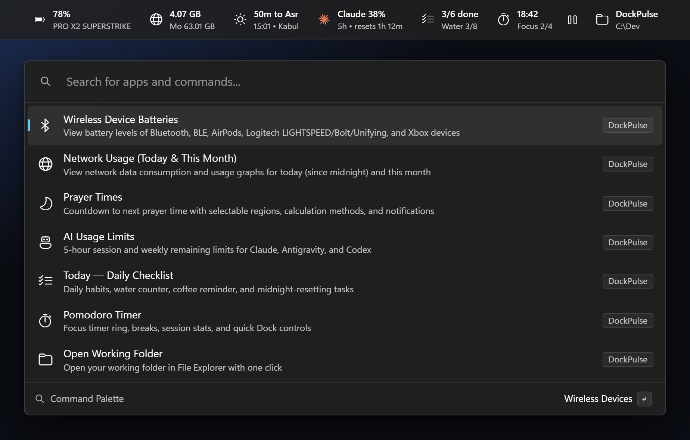
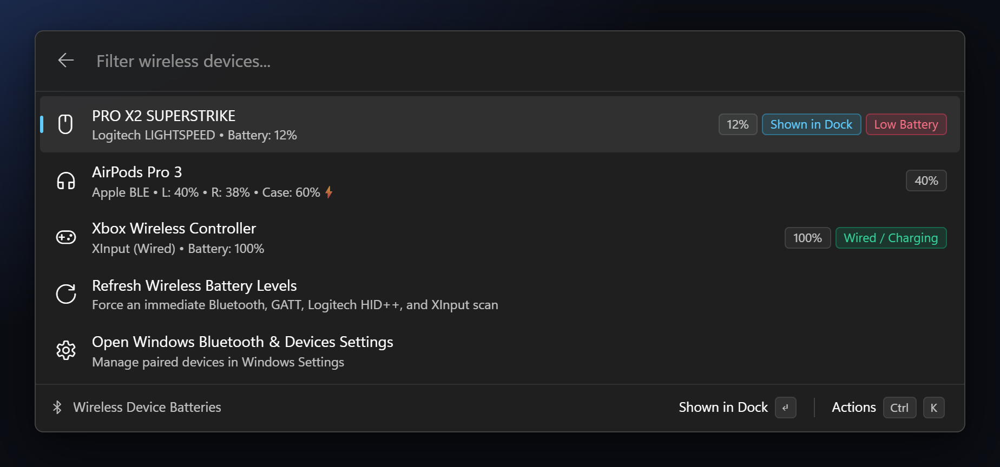
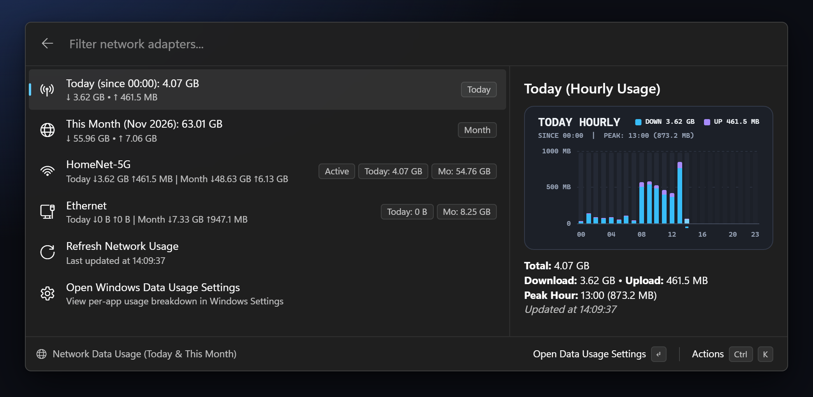
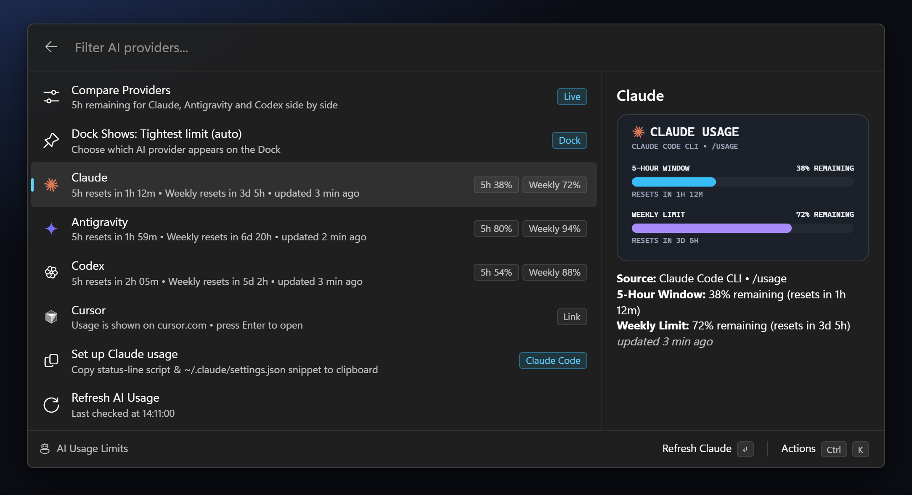
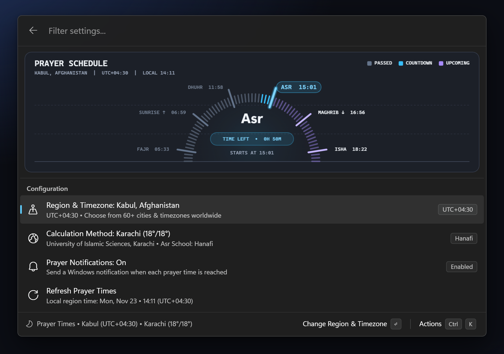

# DockPulse

DockPulse adds seven small bands to the [PowerToys Command Palette](https://learn.microsoft.com/windows/powertoys/command-palette/overview) Dock. They show your mouse and headphone batteries, how much data you've used today, how much of your Claude or Codex limit is left, the next prayer time, and a few other things you'd otherwise open an app to check.

[Get it from the Microsoft Store](https://apps.microsoft.com/detail/9NNZWHMWTZ86) or install it with winget:

```powershell
winget install 9NNZWHMWTZ86 --source msstore
```



## The bands

You can turn on any of the bands and leave the rest off. Clicking a band opens its page in Command Palette, where you'll find more detail and settings.

| Band | What it shows |
| --- | --- |
| **Wireless Battery** | Battery levels of connected Bluetooth and BLE devices, AirPods and Beats (left, right and case), Logitech devices on LIGHTSPEED, Bolt or Unifying receivers, and Xbox controllers. You choose which device the Dock shows. |
| **Network Usage** | Data used today (hour by hour) and this month (day by day), in total and for each network adapter. The numbers come from Windows' own data usage records. |
| **AI Usage Limits** | What's left of your 5-hour and weekly limits for Claude, Codex and Antigravity. The Dock can show one provider or whichever limit is closest to running out. |
| **Next Prayer Time** | A countdown to the next prayer, worked out offline. It has 61 cities in 34 countries, 10 Sunni and 2 Shia calculation methods, a Hanafi or standard Asr setting, and optional Windows notifications. |
| **Today** | A checklist that resets at midnight, with a water counter and a coffee reminder. |
| **Pomodoro** | A focus timer with short and long breaks, a start/pause button right on the Dock, and stats for today and the last 7 days. |
| **Working Folder** | One click opens your project folder in File Explorer. Its menu also opens it in VS Code or a terminal. |

## Screenshots

| Wireless batteries | Network usage |
| --- | --- |
|  |  |

| AI usage limits | Prayer times |
| --- | --- |
|  |  |

## Getting started

1. Install [PowerToys](https://github.com/microsoft/PowerToys) and turn on Command Palette.
2. Open Command Palette settings and turn on **Enable Dock**.
3. Install DockPulse from the [Microsoft Store](https://apps.microsoft.com/detail/9NNZWHMWTZ86).
4. Right-click an empty part of the Dock, choose **Edit Dock**, press **+** and pick the DockPulse bands you want. Then select **Save**.

You can also open Command Palette, type the name of a DockPulse command (for example "Pomodoro"), right-click it and choose **Pin to Dock**.

DockPulse runs on Windows 10 (version 2004) or later and Windows 11, on x64 and ARM64. I test it with PowerToys 0.102 (Preview).

### AI usage limits: what you need

- **Claude:** have the [Claude Code](https://code.claude.com/docs) CLI installed and signed in. DockPulse runs `claude -p /usage` every few minutes to read your limits.
- **Antigravity:** have the `agy` CLI installed and signed in. DockPulse runs `agy -p /usage`.
- **Codex:** nothing to set up. DockPulse reads the rate limits that Codex writes to its local session logs.
- **Cursor:** Cursor has no local way to read plan usage, so DockPulse only links to your usage page on cursor.com.

DockPulse never reads your sign-in tokens or credential files.

## Privacy

Everything runs on your PC. DockPulse makes no network requests and collects no telemetry. The only exception is the Claude and Antigravity CLIs that DockPulse starts to read your usage limits, which talk to Anthropic and Google with your existing sign-in, as they do when you run them yourself. [PRIVACY.md](PRIVACY.md) lists every file and API DockPulse reads.

## Building from source

You need:

- Visual Studio 2022 or later with the workloads listed in [`.vsconfig`](.vsconfig) (.NET desktop development, Windows application development, the Windows 11 SDK 26100 and Windows App SDK C# tools). Visual Studio offers to install them when you open the solution.
- The .NET 10 SDK.

Then:

1. Open `DockPulse.sln`.
2. Pick the `x64` (or `ARM64`) platform and the **DockPulse (Package)** launch profile.
3. Press **F5**. Visual Studio installs the package, and Command Palette picks up the extension. If it doesn't show up, run **Reload Command Palette extensions** from Command Palette.

Every push to GitHub also builds the MSIX packages in [GitHub Actions](.github/workflows/build-msix.yml). The `DockPulse-Local-Test` artifact has a self-signed package and its certificate, so you can try a build without Visual Studio.

### Where things live

```
DockPulse/
  DockBands/   one file per Dock band
  Pages/       the Command Palette pages behind each band
  Services/    the code that reads batteries, network usage, AI limits, prayer times
  Commands/    small reusable commands
ui-preview/    a no-build HTML mock of every band and page, with fake data
```

## Contributing

Bug reports, ideas and pull requests are all welcome.

- For anything bigger than a small fix, please open an issue first so we can agree on the approach before you write code.
- If your change touches the UI (a band's text, a page, a chart), update [`ui-preview/index.html`](ui-preview/index.html) first. It's a single HTML file that opens in any browser with no build step. That way we can agree on how it looks before changing the C#. [AGENTS.md](AGENTS.md) has the details.
- DockPulse promises to run locally. Please don't add network calls or telemetry.
- Support for more devices is especially welcome: other headset brands, more Logitech features, and anything else that reports a battery level.

## License

[MIT](LICENSE)
